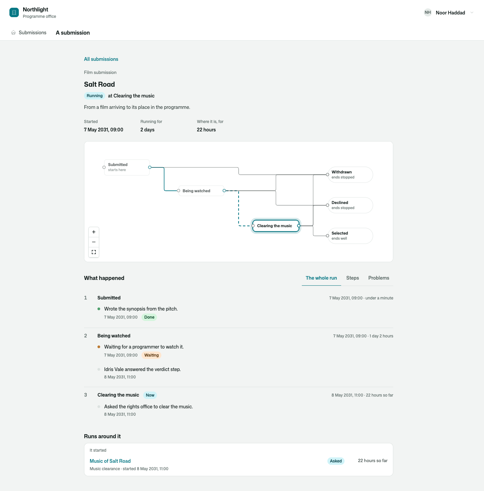
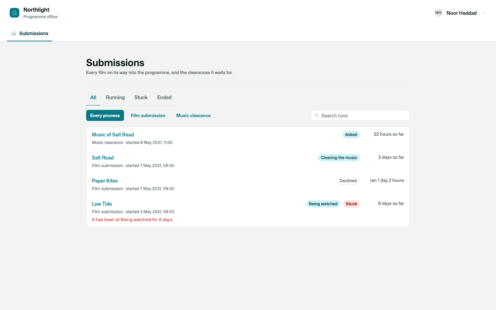
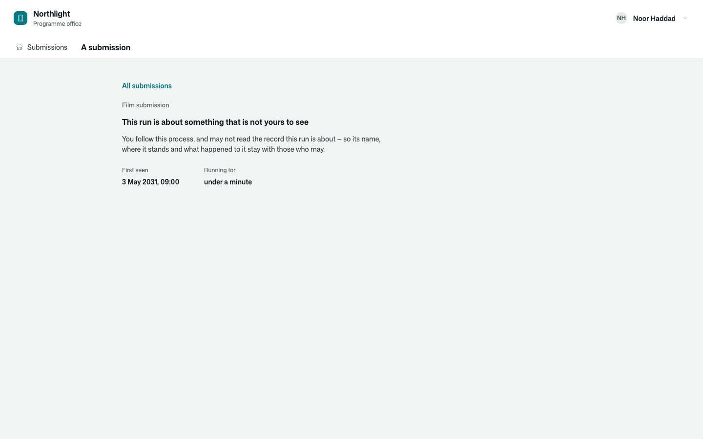
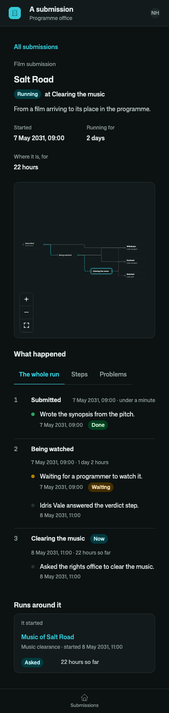

# Osysharp.Processes

Every run of a business process, findable and readable by somebody who was not there.

```osy
use Osysharp.Processes@1;

/// Taking a new supplier on.
public class TakingOn : Process<Supplier> {
  public override string Name => "Supplier onboarding";
  public override string Workflow => "Onboarding";                    // the workflow's own name
  public override WorkflowGraph Graph => Onboarding.Graph;
  public override string TitleOf(Supplier s) => s.Name;
  public override List<WorkflowAuditEntry> HistoryOf(Supplier s) => Onboarding.For(s).Audit;
}
app.Processes = new ProcessesSetup { Processes = [new TakingOn()], RunPage = "/processes/{run}" };

policy FollowsProcesses => IsOperations;                               // who opens the list and a run

[Route("/processes")]       component RunsPage()        { render { ProcessRuns(); } }
[Route("/processes/{run}")] component RunPage(Guid run) { render { ProcessRunInspector(run); } }
```



## Use case

An operations team runs supplier onboarding, contract renewal and customer offboarding as processes. Each is an
ordinary Osy# `workflow` — nothing here replaces it. What the team lacks is a place to **see** them: which runs are
going, which one has sat for a week, what happened to the one a customer is calling about, and what it cost.

- **A process is a workflow the app names.** One class says what people call it, which workflow it is, and how a
  run's title and history are read. Nothing is written in the workflow itself.
- **Listed from the moment it starts.** The kit hears the platform say that a run started, moved or ended, so a run
  is in the list at its first state — also one that only waits for a person — and an open page follows it.
- **Told when a run is stuck.** `[On] void H(ProcessStuck e)` hears of a run that has sat in one state longer than
  its process allows (`StuckAfter`), once for each stay.
- **The list.** Every run, newest first: what it is about, where it is, how long it has run, what it has spent —
  narrowed to what is running, stuck or ended, to one process, and by a word of the title.
- **One run, from start to now.** The process drawn on a canvas with where the run is and the path it took; each
  state it was in, when it got there and how long it stayed; and under each state what happened there, in order —
  who took a step, who answered one, a reminder, a deadline that passed, a step that failed.
- **The process speaks for itself.** `Processes.Note("Asked the register for the company.")` — and `Waiting`, `Done`,
  `Problem` — puts a line on the run, in the state that said it.
- **Other kits record their own steps.** A line can name what it is about, and opens in place:
  [`Osysharp.Agents.Processes`](../agents-processes) shows each piece of an agent's work that way.
- **What a run costs, against what it may.** Every model call made in a run is charged to that run by `Osysharp.Llm`
  itself; `SetProcessBudget("Onboarding", 2.00m)` holds each run to two dollars, and a call that would pass it is
  refused before it leaves.
- **Stuck is said, not hunted for.** A process says how long a run may sit in one state (`StuckAfter`); the list
  marks the ones that have, and a run whose last step failed.



## What it draws, and what it answers

| | |
|---|---|
| `ProcessRuns(opened:)` | The list, with its filters. Each run opens on the page the app named (`RunPage`); with none, `opened` is told which. |
| `ProcessRunInspector(run)` | One run: where it stands, in figures, the picture, what happened state by state (the whole run, only the steps other kits recorded, only the problems), what it spent against its limit, the run that started it and the runs it started. Read-only. |
| `ProcessRunPicture(view)` · `ProcessRunLine(card)` · `ProcessMomentLine(moment)` | The pieces, for a page of your own. |
| `ProcessMomentPanel(kind, subject)` · `ProcessRunPanel(run)` | Slots: what a line is about, opened in place; more about a run, under its history. |
| `ProcessRunsNow(filter, most:)` · `ProcessRunOf(id)` · `ProcessRunAbout(workflow, item)` | What the screens read. |
| `Processes.Note / Waiting / Done / Problem(said)` · `Processes.Here()` | What a process says about its own run, from its workflow's body. |
| `NoteOnProcessRun(line)` | A line from a kit that records its own steps on a run — for the app's own code only. |
| `SetProcessBudget(workflow, perRun)` · `SetRunBudget(run, limit)` · `RemoveProcessBudget(workflow)` · `CostOf(run)` | What each run may spend on models, and what it has. |

## Who reads what

`policy FollowsProcesses => …;` says who opens the list and a run; nobody, until the app says. What a run is **about**
is still read through the app's own rules for that row: somebody who follows the process and may not read the row
is shown that the run exists and when it was first seen — not its name, where it stands, its history or the lines
said about it. What it cost is shown to whoever may read model usage (`ReadsModelUsage`). Lines and runs are written
by the kit alone, from a workflow's run; `ErasesProcessRecords` says who deletes what the kit keeps of a run.





## Its tests

`kits/processes/tests` is the programme office of a small film festival: a submitted film gets a synopsis written
by a model, is watched by a programmer, has its music cleared by the rights office — a process of its own, started
by the first — and is selected or declined. No model is ever called.

| | |
|---|---|
| A run is told from its first state to where it is, with the time in each | `a_run_is_told_from_its_first_state_to_where_it_is` |
| A step that ends badly is told where the process handled it | `a_step_that_ends_badly_is_told_where_the_process_handled_it` |
| A run that sits too long is stuck, and the list finds it | `a_run_that_sits_too_long_is_stuck_and_the_list_finds_it` |
| The list is narrowed by process, by where runs stand and by title | `the_list_is_narrowed_by_process_by_where_runs_stand_and_by_title` |
| A run costs what was spent in it, and only who reads usage is told | `a_run_costs_what_was_spent_in_it_and_only_who_reads_usage_is_told` |
| A limit for each run holds the calls made in it | `a_limit_for_each_run_of_a_process_holds_the_calls_made_in_it` |
| A run about a row the reader may not read shows nothing of the row | `a_run_about_a_row_the_reader_may_not_read_shows_that_it_exists_and_nothing_of_the_row` |
| Somebody who follows no processes reads no run and no line | `somebody_who_follows_no_processes_reads_no_run_and_no_line` |
| A run and its lines are written only by the kit, from a workflow | `a_run_and_its_lines_are_written_only_by_the_kit_and_from_a_workflow` |
| On screen: the list, its filters, a run wide and on a phone, light and dark | `a_programmer_finds_a_run_in_the_list_and_reads_it_to_where_it_is` and three more |

```
osy test kits/processes/tests            # 13 tests
osy test kits/processes/tests --pixels   # the same in a real browser, photographed
```

## Source and package

- Package: `Osysharp.Processes` — `use Osysharp.Processes@1;`
- Source: [`kits/processes`](.) — `model/Process.osy` (what the app says), `model/Runs.osy` (what is kept, and
  `Processes.Note`), `model/Views.osy` (what the screens read), `model/Cost.osy`, `model/ui/Runs.osy`,
  `model/ui/Run.osy`
- Uses `Osysharp.Workflow`, [`Osysharp.Diagrams`](../diagrams) (the picture), [`Osysharp.Llm`](../llm) (what a run
  spent), `Osysharp.Identity` and `Osysharp.Ui`.
